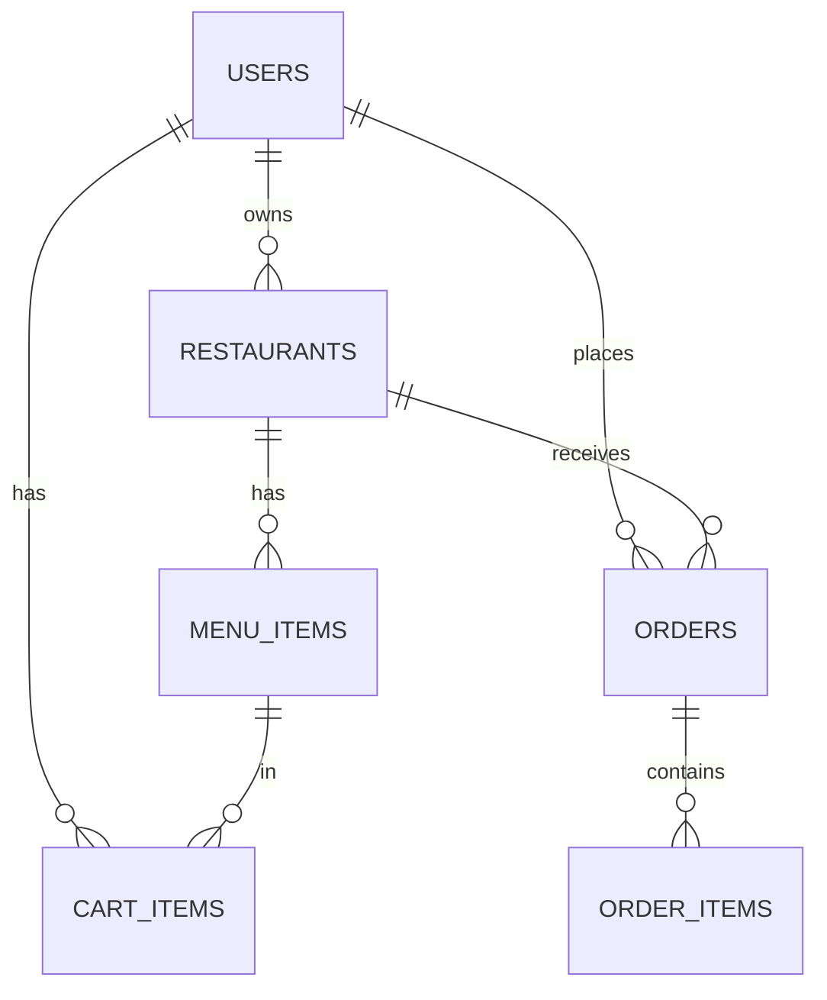

# Food Ordering Backend

A REST API for a food-ordering platform: customers browse restaurants, fill a cart and place orders; restaurant owners manage menus and move orders through their lifecycle.

**Stack:** Java 17, Spring Boot 3.3, Spring Security (stateless JWT), Spring Data JPA / Hibernate, MySQL, Maven, JUnit 5, Mockito, springdoc OpenAPI (Swagger UI), Docker.

## Features

- **Authentication and roles:** register and login return a JWT. Roles: `CUSTOMER`, `RESTAURANT_OWNER`, `ADMIN`. Passwords are hashed with BCrypt. ADMIN accounts cannot be self-registered.
- **Role-based access control:** method-level `@PreAuthorize`, plus ownership checks (an owner can only edit their own restaurant and see their own restaurant's orders).
- **Restaurants and menus:** public browsing with search by name, filter by city, pagination and whitelisted sorting. Owners create and update restaurants and menu items.
- **Cart:** one restaurant per cart, quantity limits, unavailable items rejected.
- **Transactional checkout:** the order is built from the cart in a single transaction. Prices are read from the database (never from the client), item names and prices are snapshotted into the order, and the cart is cleared only if the whole order succeeds.
- **Order state machine:** `PLACED -> CONFIRMED -> PREPARING -> OUT_FOR_DELIVERY -> DELIVERED`, with `CANCELLED` allowed from `PLACED` or `CONFIRMED`. Illegal jumps are rejected. A customer may only cancel an order that is still `PLACED`.
- **Clean error handling:** a global exception handler returns consistent JSON errors with the right status codes (400, 401, 403, 404, 409, 500) and per-field validation messages.
- **Tests:** unit tests for the state machine and order service (Mockito), and an end-to-end flow test through the real security filter chain on H2.
- **API docs:** Swagger UI at `/swagger-ui.html`.

## Run it

### Option A: Docker (easiest)

```bash
docker compose up --build
```

The API is at http://localhost:8080 and Swagger UI at http://localhost:8080/swagger-ui.html.

### Option B: locally

Requirements: JDK 17+, Maven, a running MySQL 8.

```bash
# Optional: override defaults
export DB_URL="jdbc:mysql://localhost:3306/foodorder?createDatabaseIfNotExist=true&useSSL=false&allowPublicKeyRetrieval=true&serverTimezone=UTC"
export DB_USER=root
export DB_PASSWORD=root
export JWT_SECRET="a-long-random-string-of-at-least-32-characters"

mvn spring-boot:run
```

Tables are created automatically (`ddl-auto: update`). For production, set `JWT_SECRET` to a strong value and switch to a migration tool such as Flyway.

### Tests

```bash
mvn test
```

## API overview

| Method | Path | Who | Purpose |
| --- | --- | --- | --- |
| POST | `/api/auth/register` | public | Create an account (role `CUSTOMER` or `RESTAURANT_OWNER`) |
| POST | `/api/auth/login` | public | Get a JWT |
| GET | `/api/restaurants` | public | Search, filter (`city`, `q`), paginate (`page`, `size`), sort (`sortBy`, `direction`) |
| GET | `/api/restaurants/{id}` | public | Restaurant details |
| GET | `/api/restaurants/{id}/menu` | public | Menu items |
| POST | `/api/restaurants` | owner | Create a restaurant |
| PUT | `/api/restaurants/{id}` | owner of it | Update a restaurant |
| POST | `/api/restaurants/{id}/menu` | owner of it | Add a menu item |
| PUT | `/api/menu-items/{itemId}` | owner of it | Update a menu item (including `available`) |
| GET | `/api/cart` | customer | View cart |
| POST | `/api/cart/items` | customer | Add an item |
| PUT | `/api/cart/items/{menuItemId}` | customer | Set quantity |
| DELETE | `/api/cart/items/{menuItemId}` | customer | Remove an item |
| DELETE | `/api/cart` | customer | Clear cart |
| POST | `/api/orders` | customer | Place an order from the cart |
| GET | `/api/orders/my` | customer | My orders (paginated, newest first) |
| GET | `/api/orders/{id}` | customer who placed it, restaurant owner, admin | Order details |
| PATCH | `/api/orders/{id}/status` | owner/admin (customer: cancel while `PLACED`) | Change order status |
| GET | `/api/orders/restaurant/{restaurantId}` | owner of it | Orders for a restaurant |

Send the token as `Authorization: Bearer <token>`. A ready-made walkthrough is in [`requests.http`](requests.http).

## Data model



## Project structure

```
src/main/java/com/nitin/foodorder
  config/      SecurityConfig, OpenApiConfig
  security/    JwtService, JwtAuthFilter, CustomUserDetailsService
  controller/  Auth, Restaurant, Cart, Order controllers
  service/     business rules (auth, restaurants, cart, orders)
  repository/  Spring Data JPA repositories
  entity/      JPA entities and enums (Role, OrderStatus)
  dto/         request/response records and mappers
  exception/   custom exceptions and global handler
```

## Design notes

- Stateless authentication keeps the API horizontally scalable; every request is authenticated from the JWT.
- `OrderItem` stores a snapshot of name and price so later menu edits never change past orders.
- Business rules live in the service layer and are covered by unit tests, so controllers stay thin.
- Possible next steps: Redis caching for menus, Flyway migrations, refresh tokens, payment integration, order notifications.
